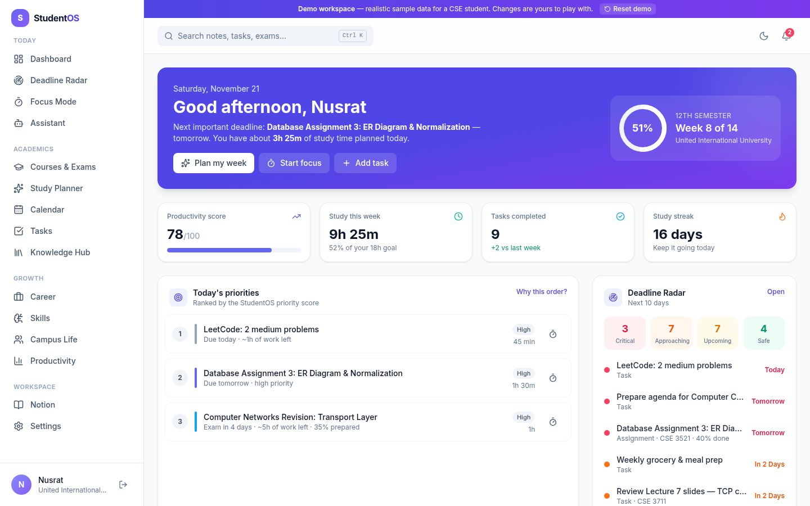
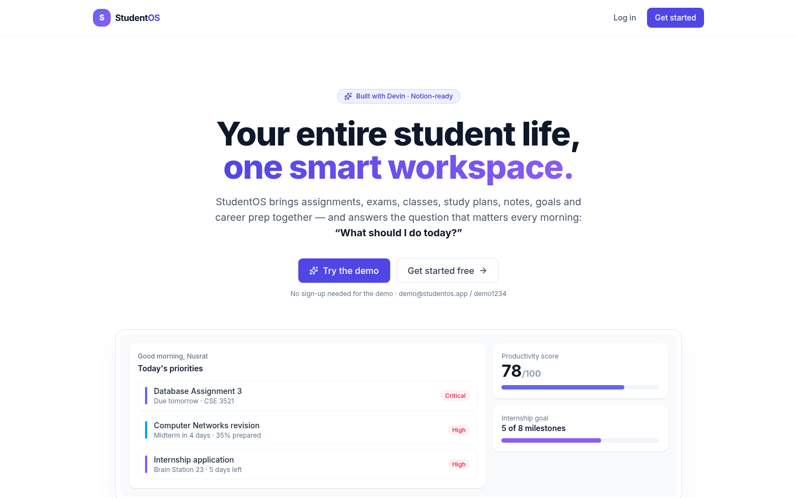
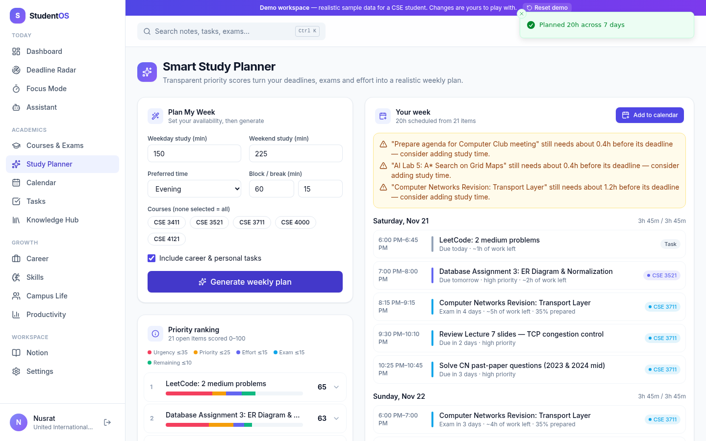
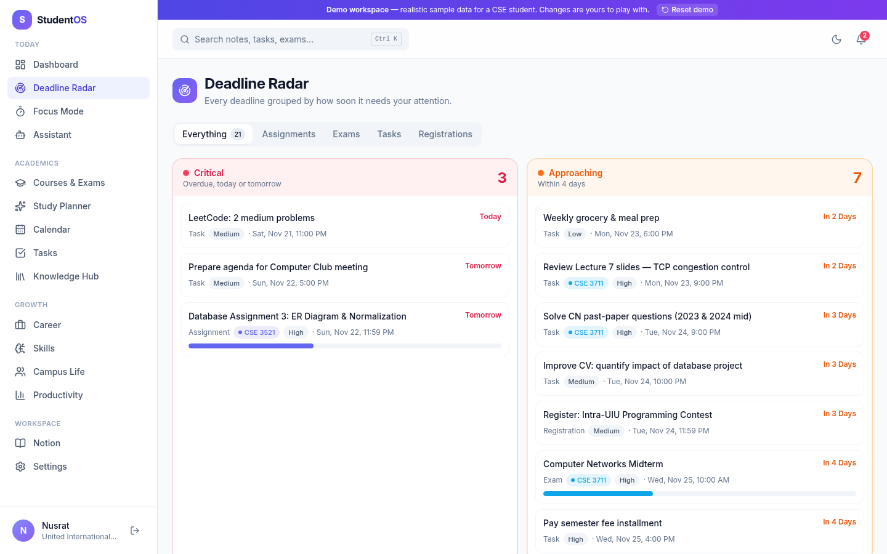
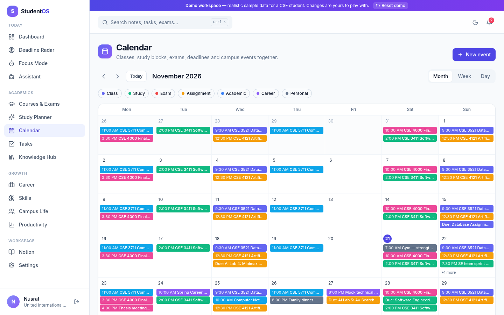
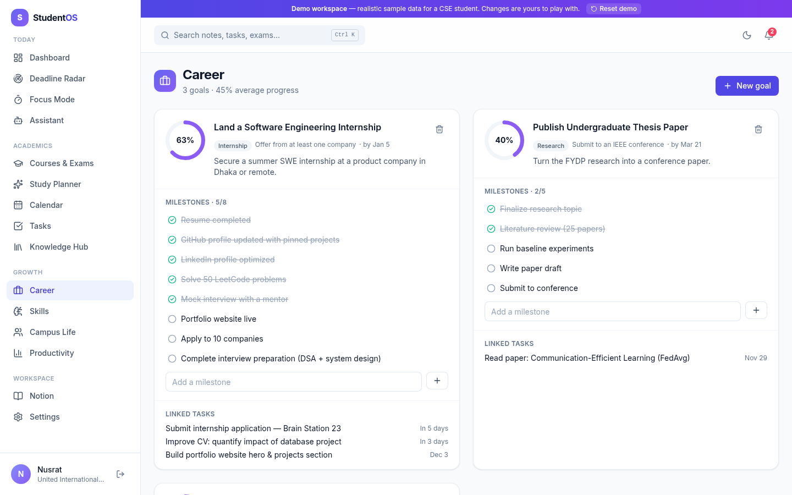
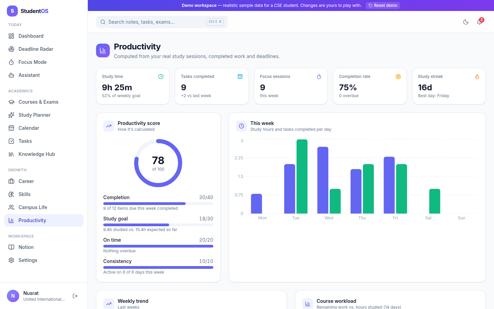
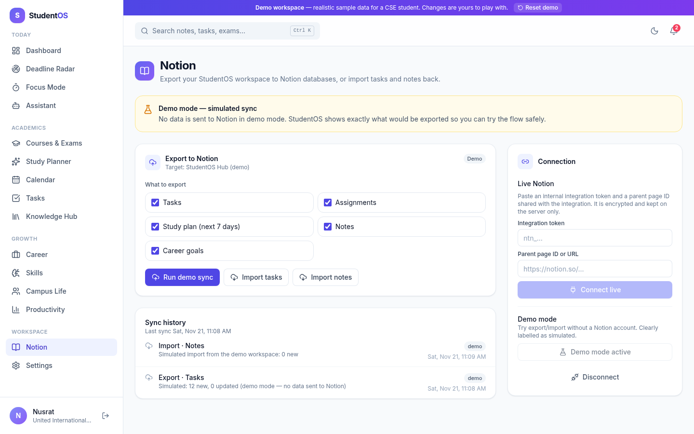
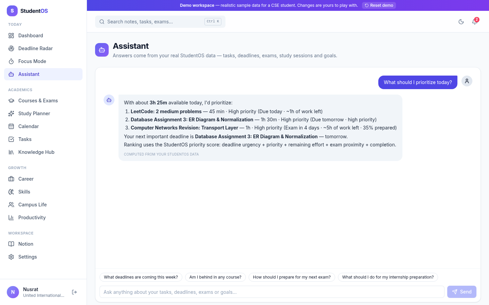
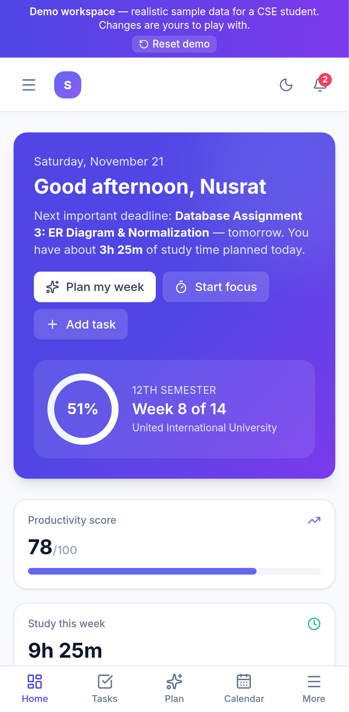

# StudentOS

**One smart workspace for your entire student life.** StudentOS answers the two questions every student asks each morning: *"What should I do today?"* and *"Am I on track?"*

Built for the **"Build a Smarter Student OS Using Devin!"** challenge. It is a full-stack web app (React + Express + Prisma) with a Notion integration that has a live mode and a clearly labelled demo mode.



---

## The problem

Student life is spread over a dozen places: LMS deadlines, a paper planner, a calendar app, Notion pages, club group chats, a job-application spreadsheet, and memory. Because of that:

- deadlines get missed because they live somewhere you didn't check,
- exams pile up without a preparation plan,
- "studying" has no measurable target, so nobody knows if they're behind,
- career prep (internships, skills, portfolio) gets pushed out by coursework.

## The solution

StudentOS puts courses, assignments, exams, class schedules, tasks, notes, career goals, skills, campus events and study sessions in one workspace. A **transparent planning engine** then turns that data into a ranked, explained list of what to do today and a realistic weekly study plan.

No LLM is required. Every recommendation comes from deterministic rules over your own data, and the score breakdown for each item is shown in the UI.

## Features

| Area | What it does |
|---|---|
| **Dashboard** | Greeting, next important deadline, semester progress, productivity score, study hours vs. goal, streak, today's ranked priorities, Deadline Radar summary, today's schedule, tasks due today, upcoming exams with preparation %, weekly study chart, recommendations, course health, career and skills progress. |
| **Courses & Exams** | Course CRUD with class schedule, instructor, credits and colour. Assignments with status, priority, difficulty, progress and estimated hours. Exams with date, location, topics and preparation %. |
| **Smart Study Planner** | Priority ranking with a visible 0–100 score breakdown. **Plan My Week** generates time blocks from your weekday/weekend availability, preferred time of day, block/break length and course filter. Capacity warnings tell you when something won't fit before its deadline. Blocks can be saved to the calendar. |
| **Calendar** | Month / week / day views. Shows classes, study blocks, exams, assignment deadlines, academic, career, personal and campus events, with type filters. Create events (double-click a time slot in week/day view), view details and delete. |
| **Tasks** | Today, Upcoming, All open, Completed and a Kanban board (drag & drop or select). Supports search, priority/category/course filters, recurrence, estimates, tags and course links. |
| **Deadline Radar** | Every open deadline grouped into **Critical** (overdue, today or tomorrow), **Approaching** (≤ 4 days), **Upcoming** (≤ 10 days) and **Safe**, with type filters. |
| **Focus Mode** | Pomodoro (25/5) or custom 25–90 min sessions. Pause/resume, link to a course, task, assignment or exam, and log the session to your study history. |
| **Productivity** | Score = completion (40) + study goal (30) + on-time (20) + consistency (10), each part explained. Weekly bars, multi-week trend, course workload vs. hours studied, career goal progress. |
| **Knowledge Hub** | Notes, lecture summaries, resources, links, project and research notes with topics, tags and course links. Global search across notes, tasks, assignments and exams. |
| **Career & Skills** | Career goals (internship, portfolio, research, …) with milestones, progress and linked tasks. Skills with current/target level (1–10), resources and linked practice tasks. |
| **Campus Life** | Organizations and their events. Save, mark interested or registered, add to calendar, create events. Registrations also appear in the Deadline Radar. |
| **Assistant** | Chat interface answering "What should I prioritize today?", "What deadlines are coming this week?", "Am I behind in any course?", exam prep, career prep and more, using your real data. An OpenAI-compatible LLM can optionally be added; the deterministic engine is always the fallback. |
| **Notion** | **Live mode:** export tasks, assignments, study plan, notes and goals to a Notion database or page, and import tasks/notes back. **Demo mode:** the same flow, clearly labelled *simulated*, and nothing is sent to Notion. Tokens are stored encrypted on the server and never returned to the browser. |
| **Also** | Landing page, register/login/logout, one-click demo account (with reset), 4-step onboarding, notifications, settings (profile, semester, study and career preferences, notifications, theme, password), light/dark/system theme, responsive layout with mobile bottom navigation, skip link, focus management, labelled controls, loading/empty/error states, toasts and confirmation dialogs. |

### How priorities are calculated

Each open task, assignment and exam gets a score out of 100. The breakdown appears in the Planner (and in the Dashboard via "Why this order?"):

| Component | Max | Based on |
|---|---|---|
| Urgency | 35 | Days until the deadline (overdue = max) |
| Priority | 25 | Your priority: low / medium / high / critical |
| Effort | 15 | Remaining hours of work |
| Exam proximity | 15 | Upcoming exam for the same course |
| Remaining | 10 | How much of the item is still unfinished |

The weekly planner schedules the highest-scoring work first into the daily minutes you said you have. It never schedules an item after its deadline, and it warns you when something won't fit.

## Screenshots

| | |
|---|---|
|  Landing |  Smart Study Planner |
|  Deadline Radar |  Calendar |
|  Career |  Productivity |
|  Notion (demo mode) |  Assistant |



## Architecture

```
┌──────────────────────────┐   /api (cookie JWT)   ┌──────────────────────────────┐
│  frontend (React + Vite) │ ────────────────────▶ │  backend (Express 5 + TS)    │
│  React Router, TanStack  │                       │  routes → controllers →      │
│  Query, Tailwind,        │ ◀──────────────────── │  services (planner, priority,│
│  Recharts                │        JSON           │  analytics, radar, assistant,│
└──────────────────────────┘                       │  notion, notifications)      │
                                                   │        │ Prisma ORM          │
                                                   └────────┼─────────────────────┘
                                                            ▼
                                       SQLite (dev) / PostgreSQL (prod-ready)
                                                            │
                                     optional: Notion API, OpenAI-compatible API
```

```
studentos/
├── backend/
│   ├── prisma/            schema.prisma, migrations, seed.ts (demo workspace)
│   ├── src/
│   │   ├── routes/        all REST endpoints (/api/...)
│   │   ├── controllers/   auth, academics, workspace, campus, insights
│   │   ├── services/      priority, planner, analytics, dashboard, recommendations,
│   │   │                  assistant, notion, notionClient, notifications, demo
│   │   ├── middleware/    auth (JWT cookie / Bearer), Zod validation, error handler
│   │   └── models/        Zod request schemas
│   └── tests/             Vitest + Supertest (unit + API)
├── frontend/
│   ├── src/
│   │   ├── pages/         one file per screen
│   │   ├── components/    layout, UI primitives, notifications
│   │   ├── lib/           api client, auth context, types, formatting, theme
│   │   └── hooks/         query/mutation helpers
│   └── e2e/               Playwright tests (demo flow, auth + tasks, mobile)
└── docs/screenshots/
```

In production, `npm run build && npm start` makes the backend serve the built frontend from `frontend/dist`, so it deploys as a single service.

## Tech stack

- **Frontend:** React 18, TypeScript, Vite 5, React Router 6, TanStack Query 5, Tailwind CSS 3, Recharts, Lucide icons, Sonner toasts
- **Backend:** Node 20, Express 5, TypeScript, Prisma 6, Zod, bcryptjs, JSON Web Tokens (httpOnly cookie), Helmet, CORS, express-rate-limit
- **Database:** SQLite for zero-config local development. Can switch to PostgreSQL.
- **Testing:** Vitest, Supertest, Testing Library, Playwright

## Database

Prisma models: `User`, `Course`, `Task`, `Assignment`, `Exam`, `Event`, `StudySession`, `Note`, `CareerGoal`, `CareerMilestone`, `Skill`, `Organization`, `OrganizationEvent`, `OrgEventInterest`, `ProductivityRecord`, `NotionConnection`, `NotionSyncLog`, `Notification`. See [`backend/prisma/schema.prisma`](backend/prisma/schema.prisma).

Every record belongs to a user, and every query is scoped to the signed-in user (ownership is covered by tests).

**Using PostgreSQL:** set `provider = "postgresql"` in `schema.prisma`, point `DATABASE_URL` at your database, then run `npx prisma migrate dev` in `backend/` to create a Postgres migration.

## Getting started

Requirements: **Node.js 20+** and npm.

```bash
git clone <this repo> studentos && cd studentos
cp backend/.env.example backend/.env      # defaults work for local dev
npm run setup                             # install, migrate the SQLite DB, seed the demo account
npm run dev                               # API on :4000, web app on :5173
```

Open http://localhost:5173 and click **Try the demo**.

### Demo account

| Email | Password |
|---|---|
| `demo@studentos.app` | `demo1234` |

The demo workspace belongs to *Nusrat*, a 12th-semester CSE student at United International University. It has 5 courses, assignments, exams, a class schedule, tasks, notes, internship and portfolio goals, skills, campus clubs and four weeks of study history. All dates are relative to today, so the demo always looks current. Use **Reset demo** in the banner to restore it.

### Environment variables (`backend/.env`)

| Variable | Required | Description |
|---|---|---|
| `PORT` | no | API port (default `4000`) |
| `NODE_ENV` | no | `development` / `production` / `test` |
| `CORS_ORIGIN` | no | Allowed browser origins, comma-separated (default `http://localhost:5173`) |
| `DATABASE_URL` | yes | `file:./dev.db` for SQLite, or a PostgreSQL URL |
| `JWT_SECRET` | prod | Long random string for signing sessions (dev fallback provided) |
| `ENCRYPTION_KEY` | prod | Long random string; encrypts Notion tokens at rest (AES-256-GCM) |
| `NOTION_TOKEN` | no | Server-side Notion integration token for live mode |
| `NOTION_TARGET_ID` | no | Default Notion database or page ID |
| `OPENAI_API_KEY` | no | Turns on LLM-phrased assistant answers (deterministic fallback otherwise) |
| `OPENAI_BASE_URL` / `OPENAI_MODEL` | no | Any OpenAI-compatible endpoint (default `gpt-4o-mini`) |

The server refuses to start in production without `JWT_SECRET` and `ENCRYPTION_KEY`.

### Scripts

| Command | What it does |
|---|---|
| `npm run dev` | Backend (tsx watch) + frontend (Vite) together |
| `npm run build` / `npm start` | Production build; backend serves the built frontend |
| `npm run db:migrate` / `npm run seed` | Apply migrations / reseed the demo account |
| `npm test` | Backend and frontend unit/API tests |
| `npm run test:e2e` | Playwright browser tests |
| `npm run typecheck` | TypeScript checks for both workspaces |

## Notion setup

StudentOS works fully without Notion. Under **Notion → Demo mode** every export/import is simulated and labelled as such.

To use **live mode**:

1. Create an internal integration at https://www.notion.so/my-integrations and copy the token.
2. In Notion, open the page or database you want StudentOS to use, then **⋯ → Connections → add your integration**.
3. Either put `NOTION_TOKEN` (and optionally `NOTION_TARGET_ID`) in `backend/.env`, or paste the token and page/database URL on the **Notion** page in the app. The token is encrypted on the server and never sent back to the browser.
4. Click **Sync to Notion**:
   - **Database target:** each item becomes a row. StudentOS maps title, status, dates, priority and course onto matching properties when they exist.
   - **Page target:** each item becomes a child page.
   Re-syncing updates pages it created before instead of duplicating them.
5. **Import tasks / notes** reads rows of the target database (or to-dos/child pages of a page) back into StudentOS.

Sync history (mode, direction, counts, errors) is shown on the Notion page.

## Tests

```bash
npm test             # 26 backend tests + 10 frontend tests
npm run test:e2e     # 3 Playwright tests (needs `npx playwright install chromium` once)
```

- **Backend (`backend/tests`)**
  - Unit tests for priority scoring, planner capacity and deadline safety, warnings, course filters, productivity score, streaks, goal progress and radar buckets.
  - API tests for registration, login, logout, validation, auth protection, task create/complete, courses, assignments, exams, dashboard calculations, radar, planner generate/save, career goals and milestones, Notion demo mode, assistant answers, demo seeding and cross-user ownership.
- **Frontend (`frontend/src`)**
  - Formatting helpers.
  - Login, registration and demo login flows.
  - Notion page showing demo mode as *simulated*, and tokens never rendered.
- **End-to-end (`frontend/e2e`)**
  - The full competition demo flow: landing → demo → priorities → radar → planner → calendar → career → focus → productivity → Notion demo sync → assistant.
  - Register → onboarding → create and complete a task.
  - Mobile bottom navigation.

## Competition demo flow

1. Open the landing page and click **Try the demo**.
2. **Dashboard:** today's ranked priorities and the next important deadline.
3. **Deadline Radar:** *Database Assignment 3* is critical, due tomorrow.
4. **Study Planner:** click **Generate weekly plan** to see blocks, reasons and capacity warnings.
5. **Calendar:** the upcoming Computer Networks exam.
6. **Career:** internship goal progress and milestones.
7. **Focus Mode:** start a 25-minute Pomodoro.
8. **Productivity:** score breakdown and charts.
9. **Notion:** **Run demo sync**, which is clearly marked simulated.
10. **Assistant:** ask *"What should I prioritize today?"* The answer comes from the same priority engine as the dashboard.

## Security notes

- Passwords are hashed with bcrypt. Sessions use an httpOnly, SameSite cookie (a Bearer token is also accepted for API clients).
- All input is validated with Zod. Errors are normalised and never leak stack traces in production.
- Helmet headers, CORS allow-list, rate limiting on auth endpoints.
- Notion tokens are AES-256-GCM encrypted at rest, used only server-side and never returned by the API.
- No secrets are committed; see `backend/.env.example`.

## Future improvements

- Google Calendar / LMS (Moodle, Canvas) import
- Push/email reminders and a PWA offline mode
- Two-way, scheduled Notion sync with conflict handling
- Shared study groups and club workspaces
- GPA tracking and grade forecasting
- Learning from actual vs. estimated time to improve future plans

## Challenge alignment

| Challenge goal | How StudentOS meets it |
|---|---|
| Practical, functional solution for student life | A working full-stack app with real auth, persistence and seeded data, not a mockup |
| Organise academics, schedule, notes, goals | Courses/assignments/exams, calendar, tasks, Knowledge Hub, career and skills in one place |
| "What should I do today?" | Transparent priority score, daily priorities, weekly auto-plan, assistant |
| Uses Notion | Live export/import via the Notion API, plus a clearly labelled demo mode |
| Built with Devin | See below |

## Built with Devin

[Devin](https://devin.ai) built this project from the challenge brief in a single session:

- Designed the data model, REST API, priority/planner algorithms, analytics and assistant intent engine.
- Wrote the Express + Prisma backend, the seed script for the demo workspace and the backend test suite.
- Wrote the React frontend: every page, the layout, UI components, accessibility and responsive behaviour.
- Implemented the Notion live client and the simulated demo mode.
- Wrote the unit, component and Playwright tests. Used browser automation to smoke-test every route, then fixed the bugs it found (a crashing scroll effect on the Assistant page, horizontal overflow on mobile, duplicate React copies breaking tests).
- Wrote this README and captured the screenshots.

The human author provided the challenge brief and requirements.
